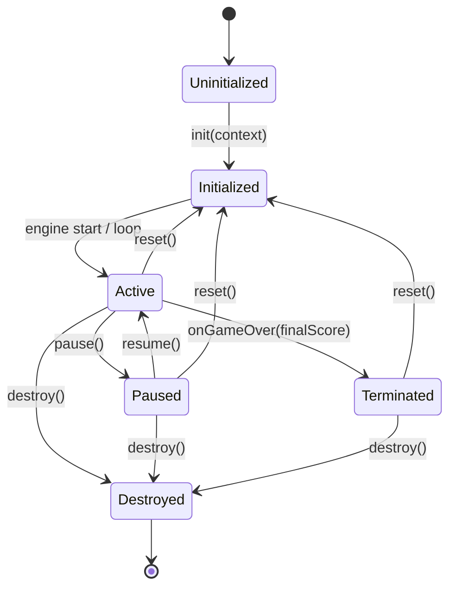

# Retro Brick Game Console - Game Interface Specification
**Version:** 1.0.0  
**Target Platform:** Web (ES6+ / HTML5 Canvas / Web Audio API)  
**Standard Grid:** 10 × 20 Virtual LCD Dot-Matrix Display  

---

## 1. Architectural Overview

The **Retro Brick Game Console** engine is architected around a strict decoupled contract between the platform infrastructure (engine loop, hardware abstraction, virtual LCD rasterizer, audio synthesizer, input pipeline, and storage) and modular game cartridges.

Every game in the console is a self-contained module that extends `BaseGame` or implements the identical lifecycle duck-type contract. Games have zero direct dependencies on the browser DOM, physical keyboard listeners, or Web Audio contexts; all interactions flow through the dependency-injected `GameContext` object.

```mermaid
flowchart TD
    ConsoleEngine["Engine.js (Fixed 60Hz Loop)"] -->|update(dt)| GameModule["Active Game (BaseGame)"]
    ConsoleEngine -->|render(context)| GameModule
    
    subgraph GameContext["GameContext Object"]
        Renderer["CanvasRenderer (10x20 LCD Matrix)"]
        Input["InputController (D-Pad, A, B, Select, Start)"]
        Sound["SoundSystem (Procedural 8-bit Web Audio)"]
        Storage["StorageManager (High Scores & Settings)"]
        UI["HUD & Modal Interface"]
        Difficulty["Difficulty Setting (EASY, MEDIUM, HARD)"]
        Callbacks["Event Callbacks (Score, GameOver, Level, Lives)"]
    end
    
    GameContext -.-> GameModule
```

---

## 2. Game Lifecycle State Machine

A game instance transitions through distinct deterministic states managed entirely by the console engine. Games must be resilient to rapid pausing, restarting, and destruction without leaking timers, event listeners, or audio nodes.



---

## 3. Standard Game Contract (`BaseGame`)

Every game module must expose an ES6 class satisfying the following 7 lifecycle methods.

```typescript
interface IRetroGame {
  init(context: GameContext): void;
  update(deltaTime: number): void;
  render(context: GameContext): void;
  reset(): void;
  pause(): void;
  resume(): void;
  destroy(): void;
}
```

### 3.1 Detailed Method Specifications

#### `init(context: GameContext): void`
- **Purpose**: Called once when the game cartridge is loaded into memory or selected from the main console menu.
- **Responsibilities**:
  - Cache the injected `GameContext` reference.
  - Allocate internal matrices, arrays, entity pools, and timers.
  - Inspect `context.difficulty` to initialize difficulty-specific parameters (speed, enemy counts, thresholds).
  - Query `context.storage.getHighScore(this.id)` to prime local high score trackers.
  - Emit initial HUD state: invoke `context.onLivesChange(this.initialLives)` and `context.onLevelUp(1)`.
- **Pre-conditions**: Canvas renderer and sound systems are fully initialized.
- **Post-conditions**: Game is ready for the first `update()` call. Game must NOT start mutating state or playing sounds until the engine triggers the active loop.

#### `update(deltaTime: number): void`
- **Purpose**: Primary physics, logic, entity movement, collision detection, and user input consumption tick.
- **Parameters**: `deltaTime` (in seconds, typically `0.0166` for a 60Hz tick). The engine caps `deltaTime` to `0.1` max to prevent spiral-of-death frame skips.
- **Responsibilities**:
  - Poll `context.input` for button presses (`isJustPressed()`, `isDown()`).
  - Advance game timers, gravity accumulators, animation cycles, and entity positions.
  - Check win/loss/hazard collision states.
  - Trigger sound effects via `context.sound`.
  - Dispatch score increments via `context.onScore(points)`.
  - Dispatch level increments via `context.onLevelUp(level)` when thresholds are reached.
  - Trigger `context.onGameOver(finalScore)` when terminal conditions are met.
- **Constraints**: **Zero memory allocations** inside `update()` to avoid GC pauses on mobile devices. Re-use pre-allocated objects and vectors.

#### `render(context: GameContext): void`
- **Purpose**: Draw the current game state to the virtual LCD matrix display.
- **Parameters**: Injected `GameContext` with active `renderer`.
- **Responsibilities**:
  - Clear the matrix buffer: `context.renderer.clear()`.
  - Draw background geometry, playing field boundaries, and stationary blocks.
  - Draw active entities (player avatar, enemies, projectiles, items, falling blocks).
  - Draw blinking/flashing elements (using `renderer.drawPixel(x, y, 2)` for blinking pixel state).
  - If the game features an auxiliary display (e.g. next falling piece), call `context.ui.showNextPiece(matrix)`.
- **Constraints**: Only write to the `renderer` virtual grid. Do not perform direct DOM manipulations.

#### `reset(): void`
- **Purpose**: Restarts the current game to its initial state without reloading the entire cartridge or re-allocating memory pools.
- **Responsibilities**:
  - Reset player position, score, level, lives, speed, and entity arrays.
  - Reset gravity and input accumulators.
  - Clear auxiliary previews via `context.ui.clearNextPiece()`.
  - Re-notify HUD: `context.onLivesChange(this.initialLives)` and `context.onLevelUp(1)`.
- **Idempotency**: Calling `reset()` multiple times consecutively must produce identical clean initial states.

#### `pause(): void`
- **Purpose**: Temporarily halts gameplay execution (e.g. user toggles Pause button, opens settings modal, or browser tab loses focus).
- **Responsibilities**:
  - Freeze all active timers and movement interpolators.
  - Stop active looping sound effects or engine hums.
  - Retain current board state and entity positions intact.

#### `resume(): void`
- **Purpose**: Restores gameplay from the paused state.
- **Responsibilities**:
  - Reset the delta accumulator to avoid a sudden time-jump spike.
  - Resume any paused looping audio if sound is unmuted.

#### `destroy(): void`
- **Purpose**: Final cleanup invoked when the user exits to the console menu, switches games, or powers down the console.
- **Responsibilities**:
  - Cancel any active `requestAnimationFrame` or `setTimeout`/`setInterval` IDs if used internally.
  - Clear entity arrays, large grid buffers, and cached closures to facilitate garbage collection.
  - Stop any looping sound effects immediately.
  - Dereference `context`.

---

## 4. The `GameContext` Object API Reference

The `GameContext` provides the complete bridge between the game module and console hardware/runtime services.

```javascript
const context = {
  canvas: HTMLCanvasElement,
  ctx: CanvasRenderingContext2D,
  renderer: CanvasRenderer,
  input: InputController,
  sound: SoundSystem,
  storage: StorageManager,
  ui: HUDController,
  difficulty: 'EASY' | 'MEDIUM' | 'HARD',
  onScore: (points) => { /* ... */ },
  onGameOver: (finalScore) => { /* ... */ },
  onLevelUp: (newLevel) => { /* ... */ },
  onLivesChange: (lives) => { /* ... */ }
};
```

---

### 4.1 `renderer: CanvasRenderer`
The virtual LCD CanvasRenderer simulates a physical dot-matrix liquid crystal display. The canonical playfield is **10 columns wide × 20 rows tall** (standard brick console proportions).

#### Matrix Coordinates:
- Origin `(0, 0)` is the **top-left corner**.
- `x` ranges from `0` to `cols - 1` (default: 0 to 9).
- `y` ranges from `0` to `rows - 1` (default: 0 to 19).

#### Pixel States:
- `0`: **OFF** (Ghost pixel / passive LCD matrix background).
- `1`: **ON** (Solid energized LCD dark segment).
- `2`: **BLINK** (Flashing LCD segment, alternates at 4Hz engine clock).

#### Method Signatures:
```typescript
interface CanvasRenderer {
  /** Returns the total column count (typically 10). */
  getCols(): number;

  /** Returns the total row count (typically 20). */
  getRows(): number;

  /** Sets a single virtual pixel state. Silently ignores out-of-bounds coordinates. */
  setPixel(x: number, y: number, state: 0 | 1 | 2): void;

  /** Returns the pixel state at (x, y). Returns 0 if out of bounds. */
  getPixel(x: number, y: number): 0 | 1 | 2;

  /** Draws an outline or filled rectangle on the virtual matrix. */
  drawRect(x: number, y: number, width: number, height: number, state: 0 | 1 | 2, filled?: boolean): void;

  /** Draws a 2D binary matrix (e.g. polyomino, sprite) at offset coordinates. */
  drawMatrix(matrix: number[][], offsetX: number, offsetY: number, state?: 0 | 1 | 2): void;

  /** Draws retro 3x5 or 5x7 alphanumeric text glyphs onto the matrix. */
  drawText(text: string, x: number, y: number, state?: 0 | 1 | 2): void;

  /** Clears the entire matrix to 0 (all pixels off). */
  clear(): void;

  /** Fills the entire matrix with the specified state. */
  fill(state: 0 | 1 | 2): void;

  /** Inverts all pixels on the playfield (useful for flash/death effects). */
  invert(): void;
}
```

---

### 4.2 `input: InputController`
The `InputController` normalizes physical keyboard keys, on-screen virtual tactile touch buttons, and physical USB/Bluetooth gamepads into standardized actions.

#### Standard Action Constants:
```javascript
export const InputActions = {
  UP: 'UP',             // D-pad Up / ArrowUp / KeyW
  DOWN: 'DOWN',         // D-pad Down / ArrowDown / KeyS
  LEFT: 'LEFT',         // D-pad Left / ArrowLeft / KeyA
  RIGHT: 'RIGHT',       // D-pad Right / ArrowRight / KeyD
  ACTION_A: 'ACTION_A', // Button A (Primary / Rotate / Jump / Shoot) / Space / KeyJ
  ACTION_B: 'ACTION_B', // Button B (Secondary / Turbo / Brake / Special) / KeyK / Shift
  START: 'START',       // Start / Pause / Enter / KeyP
  SELECT: 'SELECT',     // Select / Mode / KeyEscape / KeyO
  RESET: 'RESET',       // Reset Button / KeyR
  SOUND: 'SOUND'        // Audio Mute Toggle / KeyM
};
```

#### Method Signatures:
```typescript
interface InputController {
  /** True while the action button is continuously held down. */
  isDown(action: string): boolean;

  /** True ONLY on the single frame the action was first pressed. Automatically consumed. */
  isJustPressed(action: string): boolean;

  /** True ONLY on the single frame the action was released. */
  isJustReleased(action: string): boolean;

  /**
   * Delayed Auto Shift (DAS) helper for rapid continuous movement (e.g. falling blocks).
   * Fires on initial press, waits initialDelay ms, then fires every repeatRate ms.
   */
  checkAutoRepeat(action: string, initialDelayMs?: number, repeatRateMs?: number): boolean;

  /** Manually consumes a just-pressed event so subsequent systems do not process it. */
  consume(action: string): void;
}
```

---

### 4.3 `sound: SoundSystem`
The `SoundSystem` generates pure procedural 8-bit chiptune audio via the Web Audio API without relying on external audio files.

```typescript
interface SoundSystem {
  /** Play built-in sound effects */
  playMove(): void;       // Low tick chirp (120Hz click)
  playRotate(): void;     // Mid-tone frequency sweep (300Hz -> 500Hz)
  playDrop(): void;       // Percussive low thud (80Hz noise drop)
  playScore(): void;      // Rising two-tone arpeggio (440Hz -> 880Hz)
  playLevelUp(): void;    // Triumphant 4-note fanfare
  playGameOver(): void;   // Melancholy descending sweep (300Hz -> 75Hz)
  playShoot(): void;      // High laser pitch sweep (1200Hz -> 300Hz)
  playExplosion(): void;  // Filtered white noise decay burst
  playBounce(): void;     // Harmonic resonant blip (587Hz)
  playVictory(): void;    // Extended victory melody

  /** Synthesize a custom procedural tone */
  playTone(frequency: number, durationSeconds: number, type?: 'square' | 'triangle' | 'sawtooth' | 'noise', gain?: number): void;

  /** Audio mute / status */
  toggleMute(): boolean;
  isMuted(): boolean;
  setVolume(volume: number): void; // 0.0 to 1.0
}
```

---

### 4.4 `storage: StorageManager`
Persistent state is handled defensively through `StorageManager`, incorporating local storage fallback buffers for private browsing and quota errors.

```typescript
interface StorageManager {
  /** Returns the all-time high score for the specified game ID. Returns 0 if none stored. */
  getHighScore(gameId: string): number;

  /**
   * Persists a new high score for gameId if higher than current record.
   * Returns true if a new high score was set, false otherwise.
   */
  setHighScore(gameId: string, score: number): boolean;

  /** Generic key-value getters and setters with versioned prefix */
  getData<T>(key: string, defaultValue: T): T;
  setData<T>(key: string, value: T): boolean;
}
```

---

### 4.5 `ui: HUDController`
Controls the auxiliary hardware display sections surrounding the primary 10×20 virtual matrix.

```typescript
interface HUDController {
  /** Sends a temporary alert text banner across the screen overlay */
  showMessage(text: string, durationMs?: number): void;

  /** Displays a small 4x4 binary preview matrix in the hardware "Next Piece / Sub" display */
  showNextPiece(matrix: number[][]): void;

  /** Clears the auxiliary next-piece display */
  clearNextPiece(): void;

  /** Displays custom auxiliary telemetry (e.g. stage number, ammo count, fuel gauge) */
  showAuxiliary(text: string | number): void;
}
```

---

### 4.6 Event Callbacks
Games must communicate milestone state transitions to the platform engine through four core callbacks:

1. `onScore(points: number): void`
   - Call whenever the player earns points.
   - The engine updates the active HUD score display, runs the score roll animation, and plays `playScore()` if appropriate.
   - Automatically tests against the current high score in real-time.

2. `onGameOver(finalScore: number): void`
   - Call when player lives reach 0 or terminal fail conditions occur.
   - Engine stops the game loop, plays `playGameOver()`, checks `storage.setHighScore()`, and triggers the Game Over overlay modal.

3. `onLevelUp(newLevel: number): void`
   - Call when the player satisfies level-advancement criteria (score threshold, stage clear, distance target).
   - Engine updates the HUD Level indicator, plays `playLevelUp()`, and triggers celebratory screen blink.

4. `onLivesChange(lives: number): void`
   - Call when lives are lost or bonus lives are awarded.
   - Engine updates the physical/HUD lives counter icons.

---

## 5. Difficulty Curve Matrix

Every game receives `context.difficulty` on `init()`. Games must scale their gameplay parameters across three standardized tiers:

| Parameter Tier | `EASY` | `MEDIUM` | `HARD` |
| :--- | :--- | :--- | :--- |
| **Initial Game Speed** | 1.0× baseline (e.g. 1.0s drop interval) | 1.4× baseline (0.7s interval) | 2.0× baseline (0.45s interval) |
| **Speed Scaling per Level** | +5% speed per level | +10% speed per level | +18% speed per level |
| **Initial Lives** | 4 Lives | 3 Lives | 2 Lives (or 1 Life) |
| **Hazard Density / Spawns** | Low (30% obstacles) | Medium (50% obstacles) | High (75% obstacles + moving hazards) |
| **Score Multiplier** | 1.0× Base Score | 1.5× Score Multiplier | 2.5× Score Multiplier |
| **Tolerance / Forgiveness** | Wide collision hitboxes, generous input timing buffers | Standard tight hitboxes | Pixel-perfect hitboxes, zero delay buffers |

---

## 6. Concrete Game Template (`BaseGame.js`)

Below is the standard ES6 boilerplate class that all 23 games extend.

```javascript
/**
 * Abstract BaseGame class.
 * All 23 console games inherit from BaseGame.
 */
export class BaseGame {
  /**
   * @param {string} id Unique game identifier (e.g. 'brick-stacker')
   * @param {string} title Display name (e.g. 'Brick Stacker')
   */
  constructor(id, title) {
    this.id = id;
    this.title = title;
    this.context = null;
    this.isPaused = false;
    this.isOver = false;
    this.score = 0;
    this.level = 1;
    this.lives = 3;
  }

  /**
   * Initialize game state, cache context, setup entities.
   * @param {Object} context The console GameContext
   */
  init(context) {
    this.context = context;
    this.isPaused = false;
    this.isOver = false;
    this.score = 0;
    this.level = 1;
    
    // Set initial lives based on difficulty
    if (context.difficulty === 'EASY') this.lives = 4;
    else if (context.difficulty === 'HARD') this.lives = 2;
    else this.lives = 3;

    this.context.onLivesChange(this.lives);
    this.context.onLevelUp(this.level);
  }

  /**
   * Frame update tick.
   * @param {number} deltaTime Elapsed time in seconds
   */
  update(deltaTime) {
    if (this.isPaused || this.isOver) return;
    // Subclass implements specific logic here
  }

  /**
   * Virtual LCD render tick.
   * @param {Object} context The console GameContext
   */
  render(context) {
    context.renderer.clear();
    // Subclass renders pixels onto context.renderer here
  }

  /**
   * Reset game to level 1 clean state.
   */
  reset() {
    this.init(this.context);
  }

  /**
   * Pause gameplay.
   */
  pause() {
    this.isPaused = true;
  }

  /**
   * Resume gameplay.
   */
  resume() {
    this.isPaused = false;
  }

  /**
   * Teardown and cleanup.
   */
  destroy() {
    this.isPaused = true;
    this.isOver = true;
    this.context = null;
  }

  /**
   * Award points with difficulty multiplier.
   * @param {number} basePoints 
   */
  addScore(basePoints) {
    let multiplier = 1.0;
    if (this.context.difficulty === 'MEDIUM') multiplier = 1.5;
    else if (this.context.difficulty === 'HARD') multiplier = 2.5;

    const points = Math.round(basePoints * multiplier);
    this.score += points;
    this.context.onScore(points);
  }

  /**
   * Trigger game over.
   */
  gameOver() {
    if (this.isOver) return;
    this.isOver = true;
    if (this.context && this.context.sound) {
      this.context.sound.playGameOver();
    }
    if (this.context && this.context.onGameOver) {
      this.context.onGameOver(this.score);
    }
  }
}
```

---

## 7. Performance & Quality Standards

1. **Target Frame Rate**: Consistent 60 FPS across desktop and modern mobile browsers.
2. **Deterministic Physics**: Logic updates must rely on `deltaTime` or fixed accumulator ticks (`1/60` sec) to ensure identical behavior regardless of monitor refresh rate (60Hz, 120Hz, 144Hz, 240Hz).
3. **No Dynamic Allocations in Tick Loops**: No `new Array()`, `new Object()`, or closures created inside `update()` or `render()`. All coordinate buffers and particles must be pre-allocated pools.
4. **Resilient Touch Handling**: The input system binds pointer events with `touch-action: none` to prevent double-tap zoom, gesture delays, and scrolling lag on iOS Safari and Android Chrome.
5. **Autoplay Compliance**: Sounds are synthesized on-demand; audio context suspension is cleanly managed without throwing unhandled promise rejections.
