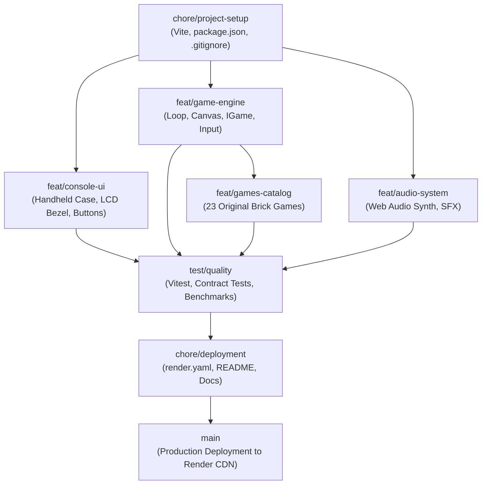

# GitButler Virtual Branch & Development Workflow

> **Repository:** `retro-brick-console`  
> **System Architecture:** 23-in-1 Retro Brick Game Console (Handheld LCD Emulator)  
> **Target Platform:** Render Static Site CDN  

---

## 1. Overview & Virtual Branch Philosophy

GitButler introduces **Virtual Branches**, allowing developers and AI agents to work on multiple logical features simultaneously within a single working directory without the friction of context switching, stashing (`git stash`), or branch swapping (`git checkout`).

In the **Retro Brick Game Console** project, development is modularized across **7 distinct virtual branches**. Each virtual branch has dedicated file ownership, explicit deliverables, and a focused scope to eliminate merge conflicts and maintain clean separation of concerns.

```
                               ┌─────────────────────────┐
                               │  chore/project-setup    │
                               └────────────┬────────────┘
                                            │
                     ┌──────────────────────┴──────────────────────┐
                     ▼                                             ▼
       ┌───────────────────────────┐                 ┌───────────────────────────┐
       │     feat/console-ui       │                 │     feat/game-engine      │
       └─────────────┬─────────────┘                 └─────────────┬─────────────┘
                     │                                             │
                     │                 ┌───────────────────────────┴─────────────┐
                     │                 ▼                                         ▼
                     │   ┌───────────────────────────┐             ┌───────────────────────────┐
                     │   │     feat/audio-system     │             │    feat/games-catalog     │
                     │   └─────────────┬─────────────┘             └─────────────┬─────────────┘
                     │                 │                                         │
                     └─────────────────┼─────────────────────────────────────────┘
                                       ▼
                         ┌───────────────────────────┐
                         │       test/quality        │
                         └─────────────┬─────────────┘
                                       │
                         ┌─────────────▼─────────────┐
                         │      chore/deployment     │
                         └─────────────┬─────────────┘
                                       │
                         ┌─────────────▼─────────────┐
                         │        main (PROD)        │
                         └───────────────────────────┘
```

---

## 2. Virtual Branch Architecture & File Ownership

| Virtual Branch | Primary Scope | Owned Directories / Files | Depends On |
| :--- | :--- | :--- | :--- |
| **`chore/project-setup`** | Tooling, build config, dependencies, structure | `package.json`, `package-lock.json`, `vite.config.js`, `.gitignore` | Base |
| **`feat/console-ui`** | Handheld body, LCD bezels, buttons, modals, HUD | `src/index.html`, `src/styles/*`, `src/js/ui/*` | `chore/project-setup` |
| **`feat/game-engine`** | 60 FPS loop, Canvas renderer, IGame interface, input | `src/js/core/*`, `src/js/engine/*` | `chore/project-setup` |
| **`feat/games-catalog`** | All 23 original brick game implementations | `src/js/games/*`, `docs/GAME_CATALOG.md` | `feat/game-engine` |
| **`feat/audio-system`** | Web Audio API 8-bit chiptune synthesis, sound queue | `src/js/audio/*` | `chore/project-setup` |
| **`test/quality`** | Vitest unit tests, game contract validation, CI scripts | `tests/*`, `vitest.config.js` | `feat/games-catalog`, `feat/console-ui` |
| **`chore/deployment`** | Render static site blueprint, headers, documentation | `render.yaml`, `README.md`, `docs/*` | All branches |

---

## 3. Virtual Branch Specifications

### 3.1 `chore/project-setup`
- **Mission:** Establish the foundation, package definitions, build tooling, and directory skeleton.
- **Key Tasks:**
  - Initialize Vanilla ES6+ project with Vite.
  - Setup scripts (`dev`, `build`, `preview`, `test`).
  - Configure `.gitignore` for node, bundler caches, test results, OS artifacts, and environment variables.
  - Setup ESLint and Prettier configurations.

### 3.2 `feat/console-ui`
- **Mission:** Build the authentic retro handheld physical console casing and interactive shell.
- **Key Tasks:**
  - Create the retro plastic housing with realistic bezel, speaker grille, and screen branding.
  - Design tactile directional D-Pad (Up, Down, Left, Right) and responsive Action buttons (A, B, Select, Start, Reset, Sound).
  - Implement full touch / pointer event bindings with zero-delay tactile response (`touch-action: manipulation`).
  - Implement dynamic LCD theme selector (Classic Green LCD, Pea Soup Game Boy, Amber Cyber, Backlit Blue, Pocket Gray).
  - Build HUD overlays (Pause modal, Game Over screen, Settings dialog, High Scores table).

### 3.3 `feat/game-engine`
- **Mission:** Engineer the core 60 FPS dot-matrix game engine and lifecycle contract.
- **Key Tasks:**
  - Fixed-timestep game loop using `requestAnimationFrame` with delta-time smoothing.
  - High-performance Canvas 2D matrix renderer supporting standard 10x20 and 20x20 LCD brick grids.
  - Uniform `IGame` interface contract:
    - `init(context)`
    - `update(deltaTime)`
    - `render(context)`
    - `reset()`
    - `pause()`
    - `resume()`
    - `destroy()`
  - Unified Input Router handling physical Keyboard (`ArrowKeys`, `WASD`, `Space`, `Enter`, `Escape`), on-screen virtual buttons, and Gamepad API.
  - State persistence manager utilizing browser `localStorage` for high scores, volume, and current theme.

### 3.4 `feat/games-catalog`
- **Mission:** Implement all 23 original classic-style retro brick games conforming to legal guardrails and originality rules.
- **Categories & Games:**
  1. **Block & Falling Puzzles:** Tetro Classic, Pentomino Fall, Color Cascade, Block Shift.
  2. **Racing & Avoidance:** Retro Formula Highway, Speed Rider, Traffic Dodge.
  3. **Shooter & Combat:** Brick Tank Battle, Space Invaders Matrix, Galaxy Patrol, Alien Swarm.
  4. **Action & Reflex:** Brick Snake Classic, Paddle Breakout, Flappy Glider, Endless Runner, Whack-a-Brick, Frogger Crossing.
  5. **Mind & Logic:** Pong Duel, Memory Match, Simon Sequence, 2048 Brick Edition, Tic-Tac-Toe LCD, Connect-4 Matrix.

### 3.5 `feat/audio-system`
- **Mission:** 100% native Web Audio API chiptune audio synthesizer with zero external audio assets.
- **Key Tasks:**
  - Oscillator synthesizers: Square wave (melody/tones), Triangle wave (basslines), Pseudo-random white noise (explosions, crashes, hits).
  - Retro piezoelectric buzzer frequency emulator.
  - Polyphonic sound queue managing priority audio triggers (move, rotate, drop, score, level up, game over, button click).
  - Master volume controller with instant mute toggle and `localStorage` state persistence.

### 3.6 `test/quality`
- **Mission:** Ensure complete stability, contract adherence, rendering performance, and accessibility.
- **Key Tasks:**
  - Unit tests verifying all 23 games implement the standard `IGame` lifecycle methods.
  - Input routing tests ensuring keyboard and touch events map accurately to game state actions.
  - High score persistence serialization and deserialization integrity tests.
  - Frame budget benchmarks ensuring 60 FPS (<16.6ms per frame) on 10x20 and 20x20 canvas render loops.
  - Accessibility audit (ARIA attributes, keyboard navigation, high contrast LCD themes).

### 3.7 `chore/deployment`
- **Mission:** Production deployment configuration, security headers, caching policies, and documentation.
- **Key Tasks:**
  - `render.yaml` Static Site configuration targeting Render global CDN.
  - Long-term immutable caching for static assets (`/assets/*`).
  - Production security headers (`CSP`, `HSTS`, `X-Frame-Options`, `X-Content-Type-Options`, `Permissions-Policy`).
  - Comprehensive `README.md` and repository handoff documentation.

---

## 4. Commit Message Conventions

This project strictly adheres to the **Conventional Commits 1.0.0** specification.

### 4.1 Structure
```
<type>(<scope>): <short imperative description>

[optional body explaining context and motivation]

[optional footer(s), e.g., Closes #123]
```

### 4.2 Allowed Types
- **`feat`**: A new user-facing feature or game implementation.
- **`fix`**: A bug fix in UI, engine, game logic, or audio.
- **`chore`**: Maintenance, repository setup, configuration, or dependency updates.
- **`docs`**: Documentation updates or markdown file changes.
- **`style`**: Code formatting, whitespace, semicolons (no logic change).
- **`refactor`**: Code restructuring without altering behavior or fixing bugs.
- **`perf`**: Performance optimizations (e.g., canvas rendering efficiency).
- **`test`**: Adding, updating, or fixing automated tests.
- **`ci`**: Deployment, build scripts, or continuous integration configurations.

### 4.3 Virtual Branch Commit Examples

#### `chore/project-setup`
```bash
git commit -m "chore(setup): scaffold Vite project with vanilla JS and canvas setup"
git commit -m "chore(config): configure production .gitignore and npm scripts"
```

#### `feat/console-ui`
```bash
git commit -m "feat(ui): design vintage handheld casing and tactile D-pad buttons"
git commit -m "feat(theme): add 5 retro LCD color palettes with instant switcher"
git commit -m "feat(modal): create high-score, pause, and settings modal dialogs"
```

#### `feat/game-engine`
```bash
git commit -m "feat(engine): implement 60 FPS fixed-timestep game loop with Canvas 2D"
git commit -m "feat(engine): define standard IGame lifecycle interface"
git commit -m "feat(input): add unified keyboard, touch, and gamepad input router"
```

#### `feat/games-catalog`
```bash
git commit -m "feat(games): implement Tetro Classic falling block puzzle"
git commit -m "feat(games): add Brick Tank Battle with 2D collision detection"
git commit -m "feat(games): integrate Retro Formula Highway racing game"
```

#### `feat/audio-system`
```bash
git commit -m "feat(audio): build Web Audio chiptune synthesizer with square waves"
git commit -m "feat(audio): add noise burst generator for crash and explosion SFX"
```

#### `test/quality`
```bash
git commit -m "test(engine): add lifecycle compliance tests for all 23 games"
git commit -m "test(perf): benchmark canvas 2D render loop under 16ms frame budget"
```

#### `chore/deployment`
```bash
git commit -m "chore(deploy): configure render.yaml with security and caching headers"
git commit -m "docs(readme): add comprehensive 23-game guide and control manual"
```

---

## 5. GitButler Workflow & CLI Commands

### 5.1 Initial Setup
```bash
# Clone the repository
git clone https://github.com/your-org/retro-brick-console.git
cd retro-brick-console

# Initialize GitButler workspace (if using GitButler GUI or CLI)
git butler init
```

### 5.2 Creating Virtual Branches in GitButler
GitButler allows multiple virtual branches to stay active on the workspace simultaneously:
```bash
# Create and activate virtual branches
git butler branch new chore/project-setup
git butler branch new feat/console-ui
git butler branch new feat/game-engine
git butler branch new feat/games-catalog
git butler branch new feat/audio-system
git butler branch new test/quality
git butler branch new chore/deployment
```

### 5.3 Assigning File Changes & Hunks to Virtual Branches
When editing files across features, GitButler allows hunk-level assignment to specific virtual branches:
```bash
# View active virtual branches and uncommitted hunks
git butler status

# Commit specific branch work
git butler commit feat/console-ui -m "feat(ui): implement tactile D-pad touch interactions"
git butler commit feat/game-engine -m "feat(engine): implement 10x20 matrix render buffer"
```

### 5.4 Standard Git CLI Fallback Workflow
For developers using traditional Git CLI without the GitButler client:

```bash
# 1. Start from main branch
git checkout main
git pull origin main

# 2. Create feature branch
git checkout -b feat/console-ui

# 3. Work on changes, stage selectively
git add src/index.html src/styles/
git commit -m "feat(ui): add retro handheld casing and LCD bezel"

# 4. Keep branch up to date with main
git fetch origin
git rebase origin/main

# 5. Push to remote
git push -u origin feat/console-ui
```

---

## 6. Dependency Graph & Merging Sequence



---

## 7. Quality Gates & Production Deployment

Before any virtual branch is merged into `main`:
1. **Lint & Format:** Code must pass linting without syntax or formatting errors.
2. **Type Safety / Standards:** Vanilla ES6+ modules with strict mode.
3. **Automated Testing:** All Vitest suites pass (`npm test`).
4. **Build Verification:** `npm run build` succeeds locally, producing `dist/`.
5. **No Broken Links:** All asset references resolve relative to `dist/`.
6. **Zero External Runtime Hosting Cost:** Render Static Site automatically builds and serves the bundle via global CDN.
