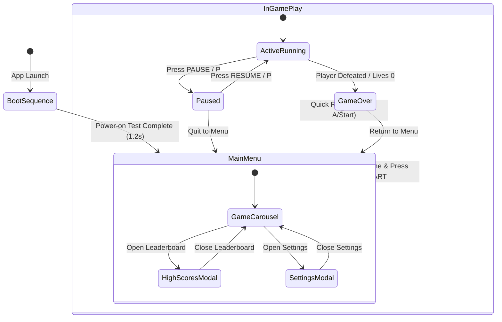

# Retro Brick Game Console — UI/UX Specification & Design System

## 1. Executive Summary & Design Vision

### 1.1 Overview
The **Retro Brick Game Console** is a web-based, authentic digital recreation of the iconic 1990s LCD handheld gaming systems (widely known in retro culture as "Brick Games" or 9999-in-1 multi-game consoles). The design merges 100% original, copyright-compliant industrial styling with high-fidelity vintage liquid crystal display (LCD) physics, tactile acoustic/haptic physical controls, and responsive modern web architecture.

### 1.2 Core Pillars
1. **Nostalgic Hardware Authenticity**: Textured molded ABS plastic chassis, recessed dual-tone bezel, authentic speaker grille apertures, cross-shaped mechanical D-pad, and domed tactile primary buttons with realistic 2.5D physical depth, depressed states, and cast shadows.
2. **Liquid Crystal Display (LCD) Fidelity**: Genuine two-layer optical look: active dark pixels (`#1a2b1a`) resting above a greenish-amber reflective polarized substrate (`#9dac86`), complete with subtle passive unlit "ghost" pixel footprints, micro-subpixel borders, and liquid crystal transition persistence.
3. **Ergonomic & Touch-First Ergonomics**: Dual-mode ergonomics supporting responsive centered handheld presentation on desktop displays and thumb-accessible zero-latency touch controls on mobile devices (320px to 480px viewports) with multi-touch support.
4. **Universal Accessibility (WCAG 2.1 AA/AAA)**: Complete keyboard navigation, visible high-contrast focus rings, screen reader announcements via ARIA live regions, custom high-contrast colorways, and respect for `prefers-reduced-motion`.

---

## 2. Retro Handheld Aesthetic & Industrial Design

### 2.1 Handheld Physical Form Factor
The console housing models the classic handheld archetype: an elongated vertical form factor with tapered ergonomic waist contours that rest naturally in human palms.

```
+-------------------------------------------------------+
|  [||||||||||||||]  MULTI-GAME BRICK CONSOLE   [=POWER=] |
|                                                       |
|   +-----------------------------------------------+   |
|   |  SILK-SCREEN ACCENT FRAME (RED / CYAN STRIPE) |   |
|   |  +-----------------------------------------+  |   |
|   |  | SCORE 004820       HI-SCORE 012400     |  |   |
|   |  | +--------------------+ +--------------+ |  |   |
|   |  | |                    | | NEXT PIECE   | |  |   |
|   |  | |   PRIMARY 10x20    | | [][][][]     | |  |   |
|   |  | |   BRICK MATRIX     | +--------------+ |  |   |
|   |  | |   ACTIVE DISPLAY   | | SPEED  [8]   | |  |   |
|   |  | |                    | | LEVEL  [3]   | |  |   |
|   |  | |                    | | LIVES  [♥♥♥] | |  |   |
|   |  | +--------------------+ +--------------+ |  |   |
|   |  +-----------------------------------------+  |   |
|   +-----------------------------------------------+   |
|                                                       |
|       [ SOUND ]      [ PAUSE ]      [ RESET ]         |
|                                                       |
|            ▲                                ( A )     |
|         ◄  ●  ►        [ SELECT ]          ROTATE     |
|            ▼           [ START  ]        ( B )        |
|       TACTILE D-PAD                      ACTION       |
|                                                       |
|                             /// SPEAKER GRILLE ///    |
+-------------------------------------------------------+
```

### 2.2 Shell Finishes & Colorways
The console chassis offers switchable authentic shell colorways configured through design tokens:

| Shell Theme | Base Color | Highlight Bevel | Shadow Bevel | Texture / Style |
| :--- | :--- | :--- | :--- | :--- |
| **Classic Vintage Gray** *(Default)* | `#d8d3c5` | `#eeebe2` | `#ada491` | Subtle matte ABS grain, warm beige tint |
| **Arcade Yellow** | `#e5a924` | `#f5c542` | `#b88012` | 1990s high-impact yellow plastic |
| **Glacial Teal** | `#32909e` | `#4cb0bf` | `#206570` | Translucent-inspired retro oceanic teal |
| **Stealth Charcoal** | `#26292d` | `#3c4046` | `#151719` | High-contrast matte dark-mode chassis |
| **Berry Crimson** | `#a1283b` | `#bf364d` | `#741927` | Deep ruby-red retro handheld variant |

### 2.3 Physical Controls & Hardware Elements

#### A. Tactile Cross-Shaped D-Pad
- **Shape & Construction**: Seamless four-directional cross with a centered concave thumb-pivot well.
- **Surface Texture**: Matte fine-stipple PBT finish (`#272a2e` with specular highlight `#3e4349`).
- **Directional Markings**: Embossed debossed arrows (▲, ▼, ◄, ►) with subtle 1px drop shadow.
- **Tactile Kinematics**:
  - Rest State: Raised 4px with crisp drop shadow (`0 4px 6px rgba(0,0,0,0.4), inset 0 1px 1px rgba(255,255,255,0.2)`).
  - Depressed State: Dynamic 3D tilt transformation (`transform: perspective(300px) rotateX(...) rotateY(...) scale(0.97)`), travel distance 2.5px, shadow collapses to 1.5px.
  - Active Press Visual Cue: Outer rim ambient occlusion tightens, subtle center pivot illumination.

#### B. Primary Action Buttons (A & B)
- **Geometry**:
  - **Button A (Rotate / Primary Action / Fire)**: Oversized spherical domed button (diameter: 64px desktop / 68px mobile), positioned higher on the right for ergonomic primary thumb contact.
  - **Button B (Dash / Drop / Secondary Action)**: Medium spherical domed button (diameter: 54px desktop / 58px mobile), positioned lower-left relative to Button A along a 35-degree natural thumb arc.
- **Coloring**: High-gloss deep cardinal red (`#ba2626` base, `#dd3b3b` top highlight, `#781616` underside rim) or arcade cyan depending on shell theme.
- **Tactile Kinematics**:
  - Rest State: Cast shadow `0 5px 8px rgba(0,0,0,0.45)`, glossy specular reflection band.
  - Depressed State: `translateY(3.5px) scale(0.96)`, shadow flattens to `0 1.5px 3px rgba(0,0,0,0.5)`.

#### C. Secondary Function Buttons
- **Buttons**: `START / PAUSE`, `SELECT / GAME`, `SOUND (Mute/Vol)`, `RESET`, and `POWER`.
- **Form**: Cylindrical or pill-shaped soft rubber membrane buttons (silicone feel).
- **Coloring**: Textured charcoal rubber (`#3d4147`) with crisp printed white silk-screen markings above or below each button.
- **Physical Feel**: Smooth, low-travel tactile depression (1.5px travel) with audible low-pitch membrane click.

#### D. Bezel Window & Screen Lens
- **Recessed Bezel**: Step-down bezel with 4-stage inset shadow (`inset 0 4px 8px rgba(0,0,0,0.55), inset 0 1px 2px rgba(0,0,0,0.8)`).
- **Decorative Silk-Screen**: Classic dual-stripe decorative perimeter border (Top/Bottom: Crimson `#c0392b` and Cobalt `#2980b9`).
- **Screen Glare & Glass Reflection**: Subtle 135-degree gradient gloss overlay (`linear-gradient(135deg, rgba(255,255,255,0.09) 0%, rgba(255,255,255,0.02) 35%, transparent 60%)`) simulating an acrylic screen protector.

#### E. Speaker Grille
- **Design**: Array of 6 to 8 angled acoustic diagonal slots located in the bottom right corner of the console body.
- **Depth Effect**: Deep inner shadow simulating sound-chamber depth with darkened acoustic mesh underlay (`#181a1c`).

---

## 3. LCD Dot-Matrix Visual System

### 3.1 Optical Layer Stack Architecture
The LCD display simulation is built with a layered optical stack:

```
+-------------------------------------------------------+  Layer 4: Glass Glare & Anti-Reflective Sheen
|  ////////////////////// GLOSS HIGHLIGHT ////////////  |  (CSS Overlay / Pointer-events: none)
+-------------------------------------------------------+
+-------------------------------------------------------+  Layer 3: Active Dark Liquid Crystal Pixels
|  [■] [■] [■] [■]  Active Segments & Brick Pixels      |  (#1a2b1a, Solid, Sharp Edges)
+-------------------------------------------------------+
+-------------------------------------------------------+  Layer 2: Passive Ghost Pixel Footprints
|  [░] [░] [░] [░]  Unlit Segments (8% - 10% Opacity)   |  (Permanent hardware grid impression)
+-------------------------------------------------------+
+-------------------------------------------------------+  Layer 1: Polarized Reflective Substrate
|  ▓▓▓▓▓▓▓▓▓▓▓▓▓▓▓▓ Substrate Base Palette (#9dac86)    |  (Microscopic horizontal polarizer grain)
+-------------------------------------------------------+
```

### 3.2 Color Palettes

```
/* Primary LCD Greenish-Amber (Vintage Standard) */
--lcd-bg-primary: #9dac86;
--lcd-bg-secondary: #8f9f78;
--lcd-pixel-lit: #1a2b1a;
--lcd-pixel-ghost: rgba(26, 43, 26, 0.08);
--lcd-border-line: rgba(26, 43, 26, 0.12);

/* Classic Monochrome Green (Game Boy / 1989 Style) */
--lcd-mono-bg: #8b956d;
--lcd-mono-lit: #1f2415;
--lcd-mono-ghost: rgba(31, 36, 21, 0.09);

/* Warm Amber Backlight (Night Edition) */
--lcd-amber-bg: #c8ab6d;
--lcd-amber-lit: #2e1d0c;
--lcd-amber-ghost: rgba(46, 29, 12, 0.08);

/* Cyber High-Contrast (Accessibility Mode) */
--lcd-cyber-bg: #0d120d;
--lcd-cyber-lit: #39ff14;
--lcd-cyber-ghost: rgba(57, 255, 20, 0.06);
```

### 3.3 Anatomy of a "Brick Pixel"
In authentic vintage handhelds, a single active "brick" on the matrix is not a flat solid block. It has a distinctive physical segmented shape:
1. **Outer Boundary Frame**: A 1px dark perimeter block with 0.5px corner bevels.
2. **Inner Gap / Recess**: A 1px gap matching the reflective background color.
3. **Inner Pip Core**: A solid central rectangular or square pip.
4. **Physical Inter-Cell Gap**: A 1.5px to 2px space between adjacent matrix cells, preventing pixels from bleeding together into an indistinct blob.

```
+---------------+  <- Outer Border (Lit Pixel Color: #1a2b1a)
| +-----------+ |
| |           | |  <- Spacer Ring (Substrate Tint)
| |   +---+   | |
| |   | ■ |   | |  <- Central Solid Pip (#1a2b1a)
| |   +---+   | |
| |           | |
| +-----------+ |
+---------------+
```

### 3.4 Canvas Resolution Standards & Matrix Grids

| Matrix / Canvas Element | Resolution / Cell Count | Cell Size (CSS / Logic) | Aspect Ratio | Primary Purpose |
| :--- | :--- | :--- | :--- | :--- |
| **Main Playfield Matrix** | 10 Columns × 20 Rows | 24px × 24px per brick | 1:2 (Native) | Primary game action area for all 23 games |
| **Extended Density Grid** *(Optional)* | 20 Columns × 24 Rows | 12px × 12px per brick | 5:6 | High-resolution puzzles (e.g. Minesweeper, 2048) |
| **Auxiliary Sub-Matrix** | 4 Columns × 4 Rows | 16px × 16px per brick | 1:1 | Next tetromino piece, incoming enemy radar, mini-map |
| **Level / Speed Bars** | 1 Column × 10 Segment Bars| 18px × 4px per bar | Vertical Bar | Real-time difficulty meter |
| **Segmented Digit Displays** | 6 Digits (Score / High) | 14px × 26px per digit | 7-Segment | Authentic 7-segment numeric telemetry |

### 3.5 7-Segment Numeric Display Specification
The HUD utilizes true 7-segment digital displays.
- Unlit segments are rendered in `--lcd-pixel-ghost` (`rgba(26, 43, 26, 0.08)`).
- Lit segments are rendered in `--lcd-pixel-lit` (`#1a2b1a`).
- Standard 6-digit score displays: `888888` formatted with leading ghost zeroes or active leading zeroes depending on configuration.
- Segment labels: `SCORE`, `HI-SCORE`, `LEVEL`, `SPEED`, `LIVES`.

---

## 4. Responsive & Ergonomic Layouts

### 4.1 Responsive Breakpoints & Viewport Adaptation

```
                    RESPONSIVE ADAPTATION MATRIX

[Viewport Width]
 < 480px (Mobile Portrait)   481px - 1023px (Tablet/Split)     >= 1024px (Desktop)
+-------------------------+ +-----------------------------+ +-----------------------------+
| [ LCD DISPLAY & HUD   ] | |  [ LCD DISPLAY & HUD      ] | |  +-----------------------+  |
|                         | |                             | |  |    VINTAGE CONSOLE    |  |
| [Sound] [Pause] [Reset] | |  [Sound]   [Pause]  [Reset] | |  |    +---------------+  |  |
|                         | |                             | |  |    | LCD SCREEN    |  |  |
|    ▲              (A)   | |      ▲                (A)   | |  |    +---------------+  |  |
|  ◄ ● ►   [SEL]   (B)    | |    ◄ ● ►    [SEL]    (B)    | |  |    [D-PAD]   [A/B] |  |
|    ▼     [START]        | |      ▼      [START]         | |  +-----------------------+  |
| (Full Screen Handheld)  | |  (Enlarged Touch Pad)       | |  (Floating Chassis on Desk) |
+-------------------------+ +-----------------------------+ +-----------------------------+
```

#### Breakpoint Specifications
1. **Mobile Portrait (`< 480px` / Smartphone Viewport)**:
   - Layout mode: **Full-bleed Virtual Handheld**.
   - The top 48% of the viewport is dedicated to the LCD Screen Bezel and HUD at maximum legibility.
   - The center 8% contains low-profile utility buttons (`SOUND`, `PAUSE`, `RESET`).
   - The bottom 44% houses ergonomic, thumb-reachable controls:
     - D-Pad anchored on bottom-left thumb zone (travel radius ~90px).
     - Action Buttons A & B anchored on bottom-right thumb zone (angled 35° outward).
     - Start and Select centered between thumbs.
   - `touch-action: manipulation;`, `user-select: none;`, `overscroll-behavior: none;` applied to prevent native browser gestures.
2. **Tablet & Foldable (`481px - 1023px`)**:
   - Layout mode: **Hybrid Console**.
   - Maintains a maximum width of 600px, centered horizontally.
   - Proportional scaling with `max-height: 96vh` and realistic ABS plastic framing.
3. **Desktop Landscape (`>= 1024px`)**:
   - Layout mode: **Desk Showcase Handheld**.
   - Console chassis renders with realistic ambient occlusion and drop shadow against a subtle retro wood grain or dark linen background (`#16181a`).
   - Handheld dimensions: Width `clamp(380px, 34vw, 520px)`, Height `clamp(680px, 90vh, 920px)`.
   - Side HUD / Keyboard companion hints (displaying keyboard shortcut hotkeys `[WASD / Arrows]`, `[Space / J]`, `[Esc]`, `[P]`, `[M]`).

### 4.2 Ergonomic Thumb Zones & Multi-Touch Architecture
- **Multi-Touch Support**: Virtual touch buttons bind directly to Pointer Events with custom tracking:
  - Player can press and hold D-Pad Left/Right while repeatedly tapping Button A (Rotate/Fire) without touch cancellation or dropouts.
  - Active touch targets feature a generous 12px invisible touch bleed area (`::after` hit area expansion).
  - Haptic feedback trigger: Tapping any button triggers `navigator.vibrate(12)` on supported mobile devices (with user toggle in settings).

### 4.3 Accessibility, High-Contrast & Motion Standards
- **Keyboard Navigation**:
  - Full keyboard control mapping:
    - `ArrowUp` / `KeyW`: D-Pad Up
    - `ArrowDown` / `KeyS`: D-Pad Down
    - `ArrowLeft` / `KeyA`: D-Pad Left
    - `ArrowRight` / `KeyD`: D-Pad Right
    - `KeyZ` / `KeyK` / `Space`: Action Button A (Rotate / Primary)
    - `KeyX` / `KeyJ` / `ShiftLeft`: Action Button B (Drop / Action B)
    - `Enter`: Start
    - `KeyP`: Pause
    - `KeyM`: Sound Toggle
    - `KeyR`: Reset
    - `Escape`: Back to Main Menu / Close Modal
  - High-visibility focus indicators (`outline: 3px solid #f1c40f; outline-offset: 3px;`) for keyboard tab navigation.
- **Screen Reader Support**:
  - Semantic ARIA attributes: Modals use `role="dialog"` and `aria-modal="true"`.
  - Live region (`<div id="aria-live-announcer" class="sr-only" aria-live="polite"></div>`) broadcasts game state changes (e.g., "Game Paused", "Level 4 Reached", "Game Over, Final Score 12,400").
- **Prefers-Reduced-Motion**:
  - Suppresses screen-shake effects during explosions.
  - Replaces rapid CRT boot flicker with an instant fade-in.
  - Disables button spring bounce animations.

---

## 5. HUD Architecture & Screen States

### 5.1 State Machine Flowchart



### 5.2 State Details & Visual Contracts

#### State 1: Boot Sequence (Power-On)
- **Duration**: 1200ms vintage self-test sequence.
- **Phase 1 (0ms - 400ms)**: Full Segment Test. Every pixel and segment on the display illuminates simultaneously (10×20 matrix completely black, 888888 on all digits, all icons active) accompanied by an authentic 2.4kHz electronic power-on beep.
- **Phase 2 (400ms - 1000ms)**: Screen clear followed by marquee scrolling text across the matrix: `"BRICK CONSOLE 23-IN-1"`.
- **Phase 3 (1000ms - 1200ms)**: Transition wipe effect opening into the Main Menu.

#### State 2: Main Menu & Game Carousel
- **Header Telemetry**: Segmented display shows `"GAME 01"` through `"GAME 23"`.
- **Card Carousel**:
  - Carousel items feature:
    - Game Index Badge (`#01` to `#23`).
    - Game Title (e.g., `BRICK FALL`, `TANK COMBAT`, `SPEED RACER`, `SERPENT QUEST`).
    - Game Category Tag (`PUZZLE`, `ACTION`, `RACING`, `ARCADE`, `SHOOTER`).
    - Personal Best / High Score indicator.
    - Mini 4×4 or 10×10 Animated LCD Pixel Preview demonstrating gameplay.
- **Controls**:
  - D-Pad Left/Right: Navigate previous/next game.
  - Button A or START: Launch highlighted game.
  - SELECT: Open High Scores Leaderboard.
  - SOUND: Cycle LCD Palettes or Mute.

#### State 3: In-Game HUD Layout
The LCD screen is split into a Primary Playfield (left) and Telemetry Sidebar (right):

```
+-------------------------------------------------------------+
|                      LCD DISPLAY (100%)                     |
| +-------------------------+ +-----------------------------+ |
| |                         | | SCORE                       | |
| |                         | | [ 0 0 4 8 2 0 ]             | |
| |                         | |                             | |
| |                         | | HI-SCORE                    | |
| |                         | | [ 0 1 2 4 0 0 ]             | |
| |      PRIMARY 10x20      | |                             | |
| |      CANVAS MATRIX      | | NEXT PIECE / RADAR          | |
| |                         | | +-------------------------+ | |
| |                         | | |  [■][■]                 | | |
| |                         | | |    [■][■]               | | |
| |                         | | +-------------------------+ | |
| |                         | |                             | |
| |                         | | LEVEL: [ 0 3 ]              | |
| |                         | | SPEED: [ 0 8 ]  ||||||||░░  | |
| |                         | | LIVES: ♥ ♥ ♥                | |
| |                         | | AUDIO: [♪ ON]               | |
| +-------------------------+ +-----------------------------+ |
+-------------------------------------------------------------+
```

- **Telemetry Elements**:
  - `SCORE`: 6-digit segmented display. Active score updates smoothly.
  - `HI-SCORE`: Persisted high score for the active game loaded from `localStorage`.
  - `NEXT`: 4×4 Sub-matrix showing next falling tetromino, incoming target, or auxiliary state.
  - `LEVEL`: Numerical level indicator (1 - 10).
  - `SPEED`: 10-step horizontal/vertical LCD bar gauge.
  - `LIVES`: 3 segmented heart / ship icons that extinguish upon taking damage.
  - `STATUS ICONS`: Dedicated unlit/lit LCD flag icons: `[PAUSE]`, `[OVER]`, `[MUTE]`.

#### State 4: Pause Screen Overlay
- **Visuals**: Primary playfield remains frozen in place with a pulsating retro LCD banner: `[ == PAUSED == ]`.
- **Options Menu**:
  - `> RESUME`
  - `  RESTART`
  - `  MAIN MENU`
- Navigable with D-Pad Up/Down; selection confirmed with Button A or START.

#### State 5: Game Over Screen
- **Visuals**: Classic screen-fill animation (brick rows fill up from bottom to top, then clear top to bottom).
- **Summary Banner**: Segmented display blinks `GAME OVER`.
- **Telemetry Card**:
  - Final Score achieved.
  - High Score celebration badge (`NEW HI-SCORE!` if broken).
  - Level reached.
- **Shortcuts**: `PRESS [A] TO PLAY AGAIN` or `PRESS [SELECT] FOR MENU`.

#### State 6: High Scores Leaderboard Modal
- Accessible from Main Menu and In-Game Pause.
- **Structure**:
  - Game Category Tabs (Brick Puzzles, Arcade Action, Shooters, Reflex/Memory).
  - Top 5 local scores per game with date timestamp, score, and level reached.
  - Action button: `CLEAR DATA` with confirmation prompt.
  - Dismiss: `CLOSE [B / ESC]`.

#### State 7: Settings Modal
- **Options**:
  - **Master Volume**: 0% - 100% retro slider with sound sample test beep.
  - **Mute Audio**: Toggle switch (Mute / Unmute).
  - **Difficulty Preset**: Easy (Speed 1), Normal (Speed 3), Hard (Speed 6).
  - **LCD Color Theme**: Cycle through `Vintage Amber-Green`, `Monochrome 1989`, `Night Amber`, `Cyber Matrix`.
  - **Ghost Pixel Visibility**: High (12%), Classic (8%), Clean (0%).
  - **Haptic Vibration**: Toggle on/off for mobile touch devices.
  - **Factory Reset**: Clears `localStorage` scores and settings.

---

## 6. Design Tokens & CSS Custom Properties

### 6.1 Design Tokens Reference (`src/styles/design-tokens.css`)

```css
:root {
  /* ==========================================================================
     COLOR TOKENS - CHASSIS & HARDWARE
     ========================================================================== */
  --console-body-bg: #d8d3c5;
  --console-body-highlight: #ece8dc;
  --console-body-shadow: #b2aa97;
  --console-body-shadow-dark: #8e8673;
  --console-texture: radial-gradient(circle at 50% 50%, rgba(255,255,255,0.06) 0%, transparent 100%);
  
  --bezel-bg: #2b2e33;
  --bezel-border: #1a1c1e;
  --bezel-highlight: rgba(255, 255, 255, 0.12);
  --bezel-accent-red: #c0392b;
  --bezel-accent-blue: #2980b9;

  /* Buttons */
  --btn-dpad-bg: #282a2e;
  --btn-dpad-highlight: #454950;
  --btn-dpad-shadow: #141517;
  --btn-dpad-arrow: rgba(255, 255, 255, 0.35);

  --btn-action-a-bg: #c0392b;
  --btn-action-a-highlight: #e74c3c;
  --btn-action-a-shadow: #781e15;

  --btn-action-b-bg: #2980b9;
  --btn-action-b-highlight: #3498db;
  --btn-action-b-shadow: #1a5276;

  --btn-meta-bg: #3f444a;
  --btn-meta-shadow: #212427;
  --btn-meta-text: #8e959e;

  /* ==========================================================================
     COLOR TOKENS - LCD DOT-MATRIX SYSTEM
     ========================================================================== */
  --lcd-bg-base: #9dac86;
  --lcd-bg-gradient-top: #a4b38d;
  --lcd-bg-gradient-bottom: #95a37e;
  --lcd-pixel-lit: #1a2b1a;
  --lcd-pixel-ghost: rgba(26, 43, 26, 0.08);
  --lcd-grid-gap: rgba(26, 43, 26, 0.04);
  --lcd-glass-glare: linear-gradient(135deg, rgba(255,255,255,0.14) 0%, rgba(255,255,255,0.03) 30%, transparent 55%);

  /* ==========================================================================
     TYPOGRAPHY & FONTS
     ========================================================================== */
  --font-hardware-label: "Helvetica Neue", -apple-system, BlinkMacSystemFont, "Segoe UI", Roboto, sans-serif;
  --font-lcd-segment: "Courier New", monospace;
  --font-lcd-pixel: "Courier New", monospace;

  /* ==========================================================================
     DIMENSIONS & ELEVATION
     ========================================================================== */
  --console-radius-outer: 28px;
  --console-radius-inner: 14px;
  --bezel-radius: 12px;
  --lcd-radius: 4px;

  --depth-shadow-console: 0 24px 48px rgba(0, 0, 0, 0.4), 0 8px 16px rgba(0, 0, 0, 0.25);
  --depth-shadow-bezel: inset 0 4px 10px rgba(0, 0, 0, 0.65), inset 0 1px 2px rgba(0, 0, 0, 0.9);
  --depth-shadow-dpad: 0 6px 0 var(--btn-dpad-shadow), 0 8px 12px rgba(0, 0, 0, 0.4);
  --depth-shadow-dpad-pressed: 0 2px 0 var(--btn-dpad-shadow), 0 3px 6px rgba(0, 0, 0, 0.3);
  --depth-shadow-btn: 0 6px 0 var(--btn-action-a-shadow), 0 8px 14px rgba(0, 0, 0, 0.35);
  --depth-shadow-btn-pressed: 0 2px 0 var(--btn-action-a-shadow), 0 3px 6px rgba(0, 0, 0, 0.25);

  /* ==========================================================================
     TRANSITIONS & TIMINGS
     ========================================================================== */
  --trans-btn-press: 70ms cubic-bezier(0.2, 0.8, 0.2, 1);
  --trans-modal: 200ms ease-out;
  --trans-lcd-fade: 80ms ease-in-out;
}
```

---

## 7. Developer Handoff & Implementation Guidelines

1. **DOM Structure**: The console chassis markup must follow semantic hierarchy:
   - `#console-container`
     - `#console-shell`
       - `#console-header` (Console branding, decorative power switch)
       - `#screen-bezel`
         - `#lcd-screen` (Canvas element, HUD sidebar, glare overlay)
       - `#controls-section`
         - `#dpad-cluster` (D-Pad cross with 4 directional buttons + center pivot)
         - `#meta-cluster` (Select, Start, Pause, Sound, Reset)
         - `#action-cluster` (Button A, Button B)
       - `#speaker-grille`
2. **Input Controller Binding**:
   - Both physical keyboard events (`keydown`/`keyup`) and virtual touch controls (`pointerdown`/`pointerup`/`pointercancel`) must trigger identical input actions in `InputController.js`.
   - Add `e.preventDefault()` on virtual button pointerdown to prevent gesture zoom or text selection.
3. **Sound System Integration**:
   - Tactile button clicks, boot sequence electronic beeps, and in-game retro sound FX are managed through Web Audio synthesizer nodes via `audio-designer` contracts.
4. **Canvas Pixel Ratio (Retina Displays)**:
   - Scale canvas logical dimensions by `window.devicePixelRatio || 1` while keeping CSS dimensions fixed for crisp LCD pixel rendering without blur.
